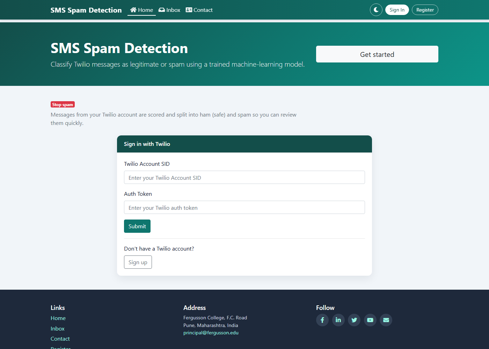
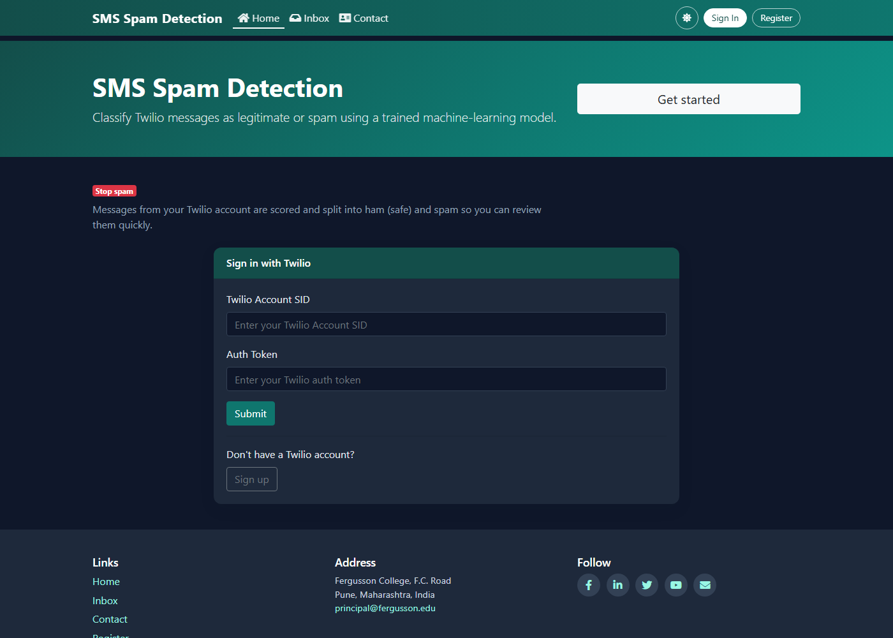
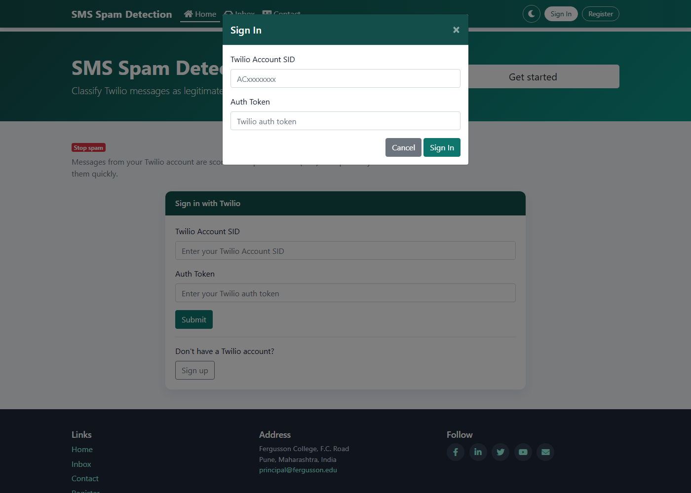
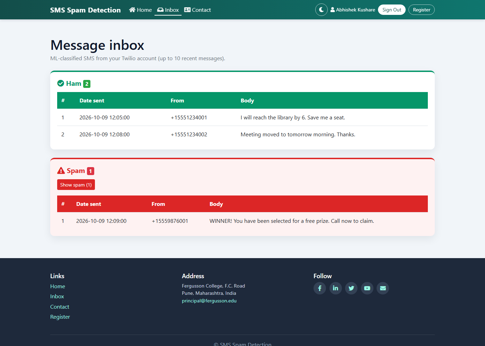
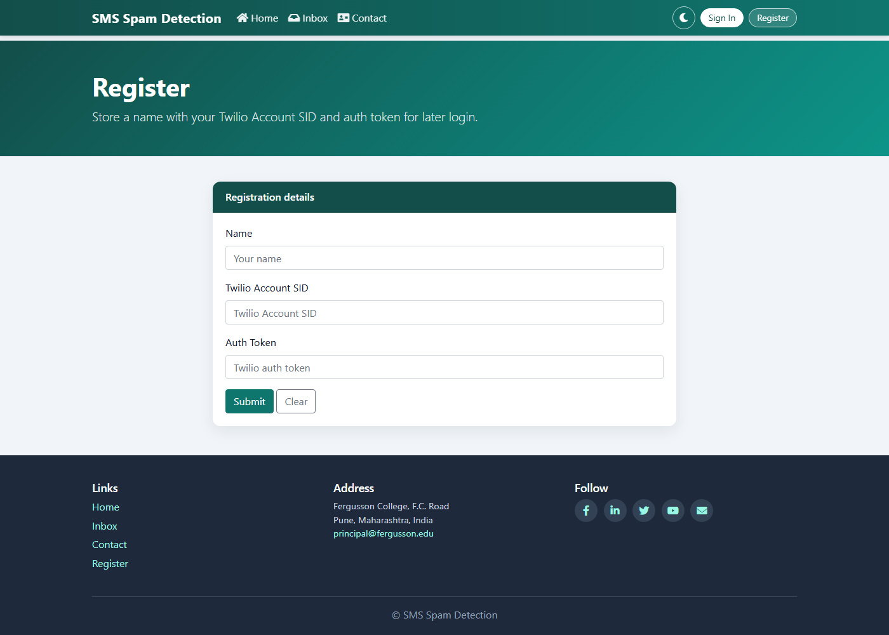

# SMS Spam Detection

**Author:** Abhishek Kushare  
**Status:** Educational prototype

A Flask web application that reads SMS messages from a Twilio account and classifies each one as **Ham** (legitimate) or **Spam**.

The formatted guide, with page numbers and the same screenshots, is [docs/SMS_Spam_Detection_Guide.html](docs/SMS_Spam_Detection_Guide.html). Open it in a browser and print to PDF if you need a paged copy.

## Contents

1. [Introduction](#1-introduction)
2. [Features](#2-features)
3. [Architecture](#3-architecture)
4. [Technology stack](#4-technology-stack)
5. [Project structure](#5-project-structure)
6. [How the application works](#6-how-the-application-works)
7. [Screenshots](#7-screenshots)
8. [Setup](#8-setup)
9. [Security notes](#9-security-notes)
10. [Future enhancements](#10-future-enhancements)
11. [Further reading](#11-further-reading)

## 1. Introduction

SMS spam is unwanted text traffic: prize scams, unsolicited promotions, and phishing. This project shows a complete path from a public SMS dataset to a small web inbox.

The audience is a student or developer learning how a web app, a database, an external SMS API, and a neural-network classifier fit together. It is **not** a production mail filter.

| Piece | Role |
|---|---|
| Flask | Pages, sign-in, and inbox |
| TensorFlow | Spam or ham prediction |
| Twilio | Source of live SMS messages |
| MySQL | Optional saved account row |

## 2. Features

- Sign in with a Twilio Account SID and Auth Token.
- Pull the latest messages from that Twilio account.
- Score each message with a saved Keras model.
- Show ham and spam in separate inbox sections.
- Optional registration of a name, SID, and token in MySQL.
- Light and dark theme, saved in the browser.
- Shared header and footer, including social icons.

## 3. Architecture

```text
Browser
  │
  ▼
Flask (app.py) ── MySQL users table (optional registration)
  │
  ├── Twilio API  → recent SMS
  └── model.py    → tokenizer + TensorFlow model → Ham or Spam
```

Details, request flow, and session behaviour are in [docs/ARCHITECTURE.md](docs/ARCHITECTURE.md).

## 4. Technology stack

| Technology | Version used here | Purpose |
|---|---|---|
| Python | 3.10.11 | Runtime |
| Flask | 2.2.5 | Web application |
| TensorFlow / Keras | 2.10.1 | Train and run the classifier |
| NumPy | 1.23.5 | Arrays |
| pandas | 1.5.3 | Read `spam.csv` |
| scikit-learn | 1.2.2 | Train/test split and metrics |
| python-dotenv | 1.0.1 | Read `.env` |
| Twilio Python SDK | 9.11.2 | Fetch SMS |
| Flask-MySQLdb / mysqlclient | 2.0.0 / 2.3.0 | MySQL access |
| MySQL Server | 8.x | Registration database |
| Bootstrap | 4.5.2 | Layout |
| Font Awesome | 5.15.4 | Icons |
| Jupyter notebook | 6.5.7 | Optional training notebook |

Windows setup steps are in [docs/SETUP_WINDOWS.md](docs/SETUP_WINDOWS.md). Model training is in [docs/MODEL.md](docs/MODEL.md).

## 5. Project structure

```text
spam-detection/
├── app.py                      # Routes, Twilio, MySQL
├── model.py                    # Load model and tokenizer
├── train_export_model.py       # Retrain and export artifacts
├── spam-detection-explore.ipynb
├── spam.csv
├── requirements.txt
├── setup_mysql.sql
├── templates/                  # Pages and shared partials
├── static/css/style.css
└── docs/                       # This documentation
```

These stay out of Git on purpose: `.env`, `.venv/`, and `spam_model/`. Generate the model locally before the inbox can classify messages.

## 6. How the application works

1. The visitor opens Home and submits a Twilio Account SID and Auth Token.
2. Flask checks Twilio by fetching that account. A matching MySQL row is optional.
3. On success the name (or the SID) is stored in the session and the browser goes to Inbox.
4. Inbox loads up to 10 recent Twilio messages.
5. `process_sms()` turns each body into an 8-token sequence.
6. The model returns a probability. **Above 0.5 is Spam. Otherwise it is Ham.**
7. Sign Out clears the session.

Registration writes `name`, `authid`, and `tno` into `SMS_SPAM_DETECTION.users`. The column `tno` holds the Auth Token in this prototype, not a phone number.

## 7. Screenshots

Home, light theme:



Home, dark theme:



Sign-in dialog:



Inbox after sign-in. The rows in this figure are sample messages used for the documentation shot:



Registration:



## 8. Setup

Short version:

```powershell
& "C:\Users\kusharea\AppData\Local\Programs\spam310venv\Scripts\Activate.ps1"
cd "...\spam-detection"
pip install -r requirements.txt
python train_export_model.py
python app.py
```

Then open `http://127.0.0.1:8001`.

Create `.env` locally (never commit it):

```env
MYSQL_HOST=localhost
MYSQL_USER=your_mysql_user
MYSQL_PASSWORD=your_mysql_password
MYSQL_DB=SMS_SPAM_DETECTION
FLASK_SECRET_KEY=replace-this
```

Twilio credentials are typed into the Sign In form. They are not required in `.env`.

## 9. Security notes

- Do not commit `.env`, Auth Tokens, or Account SIDs.
- The `tno` column stores a token in plain text. That is acceptable only for a local demo.
- The Twilio client is kept in process memory, so this build is for one user at a time.
- `debug=True` in `app.py` is for local development only.

## 10. Future enhancements

Kept short on purpose:

- Load the TensorFlow model once at startup.
- Request only the 10 messages that the inbox displays.
- Show the model score next to each message.
- Store Twilio tokens encrypted, or stop storing them.
- Split prediction into a small REST endpoint.

## 11. Further reading

| Document | What it covers |
|---|---|
| [docs/ARCHITECTURE.md](docs/ARCHITECTURE.md) | Routes, data flow, database, UI |
| [docs/MODEL.md](docs/MODEL.md) | Dataset, network, training, limits |
| [docs/SETUP_WINDOWS.md](docs/SETUP_WINDOWS.md) | Python 3.10, MySQL, venv, runbook |
| [docs/SMS_Spam_Detection_Guide.html](docs/SMS_Spam_Detection_Guide.html) | Same material with page numbers |

## License and dataset

Training text is the public [SMS Spam Collection](https://archive.ics.uci.edu/dataset/228/sms+spam+collection) (`spam.csv`, 5,572 messages). Application code in this repository is an educational project by **Abhishek Kushare**.
